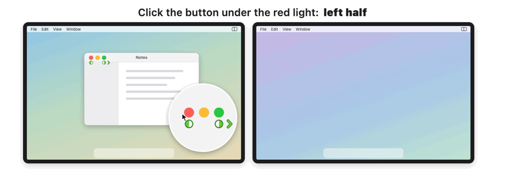
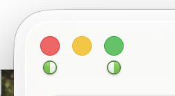
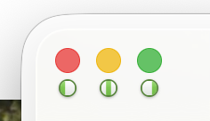
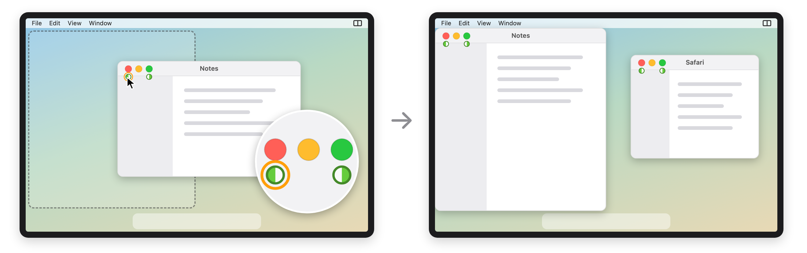
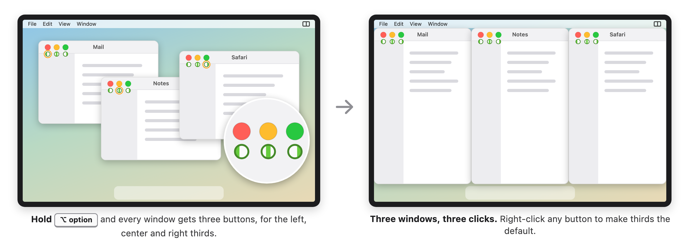
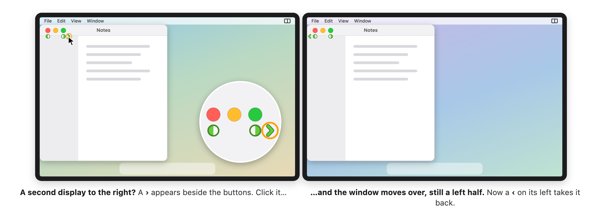

# GreenTile


This app is for anyone who wants quick access to buttons for moving and resizing macOS windows.

It’s made mostly with Claude. I’m sharing it here so you can just download it instead of spending a couple of hours doing what I did. ;)

## Download

**[Download GreenTile.zip](https://github.com/peculiarimages/GreenTile/releases/latest/download/GreenTile.zip)**
(see all versions on the [Releases page](https://github.com/peculiarimages/GreenTile/releases)).
Unzip it, drag **GreenTile.app** to your Applications folder, and open it from there. Move it first:
a permission granted while it runs from Downloads doesn't stick. It needs macOS 14 or later.

The download is **not notarized by Apple**, so the first time you open it macOS will say it can't
check the app for malicious software. Right-click > Open no longer gets past this on current macOS.
After that first blocked attempt, open **System Settings > Privacy & Security**, scroll to the
Security section, and click **Open Anyway** next to the GreenTile message (it only appears after
the blocked attempt, and asks for your password or Touch ID). Or run
`xattr -dr com.apple.quarantine /Applications/GreenTile.app` in Terminal. Then switch on
**Accessibility** access for it: GreenTile opens a window that explains how, along with System
Settings at the right page (see [Requirements](#requirements)). A SHA-256 checksum is
published next to each download (`GreenTile.zip.sha256`), and the full source is in this
repository if you would rather build it yourself.

**Updating:** from 0.1.8 on, choose **Update GreenTile…** in the menu-bar menu. GreenTile checks GitHub for a newer
release, downloads it, checks it against its published SHA-256 and its code signature, replaces
itself in Applications and restarts. Each version is a new app as far as macOS is concerned, so the
old Accessibility switch no longer applies: the updater clears it, and the new version asks again,
so you only need to switch GreenTile on once more. Open Anyway shouldn't be needed, because a file
the app downloads itself is not quarantined.

**Version 0.1.7 or earlier has no updater, so update by hand once:** quit GreenTile, replace the app
in Applications with the new download, open it, click Open Anyway if asked, and use **Ask Again** in
GreenTile's permission window if Accessibility looks on but no buttons appear.

## What it does

A small macOS menu-bar utility that puts tiling buttons right under the traffic lights of every
window, so you can snap a window to the left or right half of the screen with one click: no
hovering, no menu, no keyboard shortcut to remember.



<p align="center">
  
  &nbsp;&nbsp;
  
  <br><sub>Two buttons for halves, and three for thirds while you hold Option, or after you right-click a button.</sub>
</p>


<p align="center"><sub><b>Click the button under the red light, and the window fills the left half.</b> The one under the green light does the right half.</sub></p>


<p align="center"><sub><b>Hold Option, or right-click any button, and every window gets three buttons</b>, for the left, center and right thirds. Option shows them while you hold it; a right-click makes thirds the default.</sub></p>


<p align="center"><sub><b>Two displays:</b> a › beside the buttons sends the window to the display on the right, still a left half. A ‹ on its left brings it back.</sub></p>

Each button sits directly below one of the traffic lights, centred on it, and is drawn like a
miniature green traffic light: half green for the part of the screen the window will take, half
white for the rest. The green is `#66CC3D`, the average of the system's green traffic light, and
the outline is that green with 33% black added (`#448929`).

- **Two buttons:** left half under the red button, right half under the green one (the yellow one
  is left clear). Click ◐ and the window fills the left half of the display it is on (the area
  below the menu bar and beside the Dock); click ◑ for the right half.
- **Hold Option (or right-click):** three buttons, left, center and right third, one under each traffic
  light. Release Option and it goes back to two; after a right-click it stays at three (see below).
- **Right-click** (or Control-click) any button to switch between halves and thirds for good. With
  thirds as the default, holding Option shows the halves instead, so Option always turns the
  current row over. The menu-bar icon has the same switch ("Thirds Instead of Halves"), and the
  choice is remembered.
- **Hover** a button for a second and a small bubble says what it does and how to switch. It stays
  while the pointer is on the button or on the bubble, and goes once the pointer has been away from
  both for 2 seconds (or straight away when you click). Every bubble ends with the project's address
  next to the app icon; click anywhere on that row to open the project page in your default browser.
- **Per app:** the menu-bar menu has three choices for the app in front: **Buttons and Chevrons**
  (the default), **Chevrons Below Buttons** (for apps such as LINE whose title bar has no room
  beside the traffic lights: the `‹` goes under the left button and the `›` under the right one),
  and **Hide GreenTile** (no buttons on that app's windows, and GreenTile leaves them alone).
  Every app with its own setting is listed under "Apps with Their Own Setting", where it can be
  changed or set back to the default.
- **Several displays:** when the display a window is on has another display to its left, a chevron
  `‹` appears to the left of the leftmost button, and when there is one to its right, a chevron `›`
  appears to the right of the rightmost button. Clicking one sends the window to that display,
  covering the same share of it (a window tiled to a left half stays a left half). Hovering it names
  the display. With a single display, or on the side of a window that has no neighbour, there is no
  chevron; the tiling buttons are the same either way.
- **Stage Manager:** drag a tiled window in from the Stage Manager strip and, once you let go, it
  goes back to the tile it had in its old stage: a window that was a left half becomes the left half
  of the stage in front. Windows that were not tiled stay where you drop them. The tile is read from
  where the window actually is, so a window you put on a half or third yourself counts too, as long
  as it lines up with GreenTile's tile to within a couple of points (macOS's own tiling leaves
  margins unless "Tiled windows have margins" is off in Desktop & Dock settings). Switch it off with
  "Keep Tiles in Stage Manager" in the menu-bar menu. When GreenTile puts a window back, its icon
  shows for a moment in the middle of the window, so you can tell the move was GreenTile's.
- **Dragging to another display:** drag a tiled window onto another display and, once you let go,
  it takes the same tile there: a left half becomes the left half of the new display. Drag it off its
  tile on the same display and it stays where you put it (and is no longer treated as tiled). Switch
  it off with "Keep Tiles Across Displays" in the menu-bar menu. The same icon shows when it snaps.

The buttons hide behind any window that covers theirs, never steal focus when clicked, and follow
their window as it moves. They work on every display, including displays arranged to the left of
or above the main one. Only the active window's buttons are fully opaque: windows in the
background get half see-through buttons, so they stand out less.

## Requirements

- macOS 14 or later.
- Xcode 15 or later, only if you build it yourself.
- **Accessibility permission.** GreenTile finds each window's traffic lights and moves windows
  through the Accessibility API, so it needs to be switched on in System Settings > Privacy &
  Security > Accessibility. Without it nothing appears. Until it is granted, GreenTile asks in every
  way macOS allows: the system prompt (macOS only shows it once per app), its own window with the
  steps, and System Settings opened at the Accessibility list, where GreenTile is already added and
  only needs switching on. The window closes by itself once access is on. If GreenTile is switched
  on but still not trusted (an entry left over from an older build), **Ask Again** in that window
  removes GreenTile's entry and asks afresh. The window is also under the menu-bar icon's
  "Grant Accessibility Access…".

## Build and run

```sh
git clone https://github.com/peculiarimages/GreenTile.git
cd GreenTile
open GreenTile.xcodeproj      # then press Run
```

or from the command line: `xcodebuild -project GreenTile.xcodeproj -scheme GreenTile build`.

The GreenTile icon (the capybara with its green tile) appears in the menu bar. From there you can hide the buttons, switch to thirds,
check the permission, have GreenTile open at login, and update it (**Update GreenTile…**).
**About GreenTile**, just above Quit, shows the version and a link to the project page.

### Signing and the Accessibility permission

By default the app is signed "to run locally" (ad-hoc), which works on any Mac without a developer
account. macOS ties the Accessibility permission to an app's code signature, and an ad-hoc
signature changes with every build, so you may have to grant the permission again after each
rebuild. For a stable signature, copy `Config/Local.xcconfig.example` to `Config/Local.xcconfig`
(git ignores it) and put in your own signing identity and team ID. The permission then survives
rebuilds. (The ad-hoc build also has the hardened runtime switched off: with it on, macOS refuses
to load an ad-hoc-signed app's own embedded framework.)

### Tests

```sh
xcodebuild -project GreenTile.xcodeproj -scheme GreenTile -destination 'platform=macOS' test
```

runs the unit tests for the layout and placement logic.

## How it works

- **Following windows.** The Quartz window list is polled (60 Hz for a second after any click,
  drag, app switch or Option press, about 7 Hz otherwise) to track every window's position and
  stacking. Each poll checks that a window's buttons are still directly in front of it, because the
  system moves a window above its buttons whenever it is brought forward.
- **Finding the traffic lights.** Accessibility is asked, on a background queue and only for new
  windows plus a re-check every 1.5 s, where each window's red and green buttons are. Windows
  without them (dialogs, panels, fixed-size windows, native full screen, Stage Manager thumbnails)
  get no buttons.
- **Stacking.** Each button is its own small, transparent, non-activating panel (so the space
  between buttons is genuinely empty and clicks there reach the window), ordered directly above its
  window. A window in front of it hides its buttons too, and clicking never steals focus.
- **Tiling.** Sets the window's size and position through Accessibility. Tile edges are rounded
  once and shared, so neighbouring tiles always meet exactly.
- **Stage Manager.** Each poll remembers which tile (if any) every window is on once it has settled
  with no mouse button held. A window that arrives on screen with a remembered tile, such as one
  dragged in from the Stage Manager strip, is tiled again within 4 s, at most twice, and only while
  Stage Manager is on.
  A tiled window that settles on a different display than the one its tile was remembered on, and
  off any tile, gets the same tile on its new display, with the same limits.

## Project layout

- `GreenTileKit/` pure geometry, layout, placement and help-text logic (no AppKit), covered by
  `GreenTileKitTests/`.
- `GreenTile/Accessibility/` Accessibility wrappers, the window list and the per-window scan.
- `GreenTile/Overlay/` the round button, its panel, the help bubble, and the controller that keeps
  one panel per button.
- `GreenTile/Actions/` the tiling action.
- `docs/images/` the screenshots and illustrations in this README (`illustrations.html` draws the
  mock displays; open it with `#f1`, `#f2` or `#f3` and take a 1320 × 415 screenshot at 2×).
- `docs/images/demo.gif` comes from `animation.html` (one 1320 × 445 screenshot per frame at
  `#t=<seconds>`, 12 per second) put together with `swift Scripts/make-gif.swift <frames dir> demo.gif 0.75 0.0833`.
- `Config/` build settings, including the signing setup described above.
- `project.yml` is the source of truth for the Xcode project. Edit it and regenerate with
  [XcodeGen](https://github.com/yonaskolb/XcodeGen) (`xcodegen generate`).

Debug builds (not the downloadable Release build) have developer switches. Each runs once and exits; start them with
`open -n GreenTile.app --args <switch> <path>` so the app itself, not your terminal, holds the
Accessibility permission:

| Switch | Does |
|---|---|
| `--render-overlay <dir>` | writes light/dark PNGs of the buttons, the help bubble and the permission window |
| `--dump-windows <file>` | reports every window the scan finds and where its buttons would go |
| `--selftest-tile <file>` | tiles a throwaway window to every layout on every display and checks the result |
| `--selftest-stacking <file>` | re-fronts a throwaway window repeatedly and checks its buttons come back in front |
| `--selftest-modes <file>` | fakes the Option key and delivers right-/Control-click events; checks each button sits under its light, the halves/thirds switching, and every button's result |
| `--selftest-displays <file>` | parks a throwaway window on each real display (needs two) and checks the chevrons: where they appear, their help, and the move across |
| `--selftest-help <file>` | hovers buttons with synthetic events and a simulated pointer; checks the help bubble's timing, text, placement, the 2 s away delay and its dismissal |

## Known limits

- The buttons cover whatever is underneath them: the top-left corner of the window's content (a
  sidebar's first row, for example). They hide while another window covers them, but not on hover.
- Some apps with a minimum window size cannot be squeezed to exactly half or a third of a display.
- Windows on other Spaces, or parked in the Stage Manager strip, have no buttons until shown.
- To tell which Accessibility window is which, GreenTile uses a private Accessibility symbol
  (`_AXUIElementGetWindow`) that most window managers rely on. It is not App Store compatible.

## License

[MIT](LICENSE). GreenTile is an independent project and is not affiliated with or endorsed by
Apple. macOS and Stage Manager are trademarks of Apple Inc.
